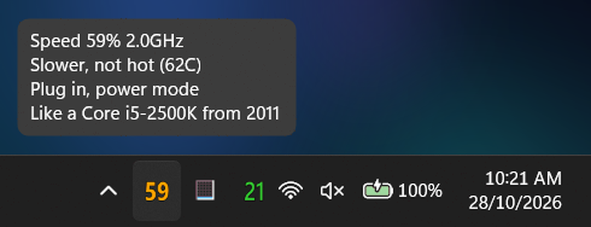
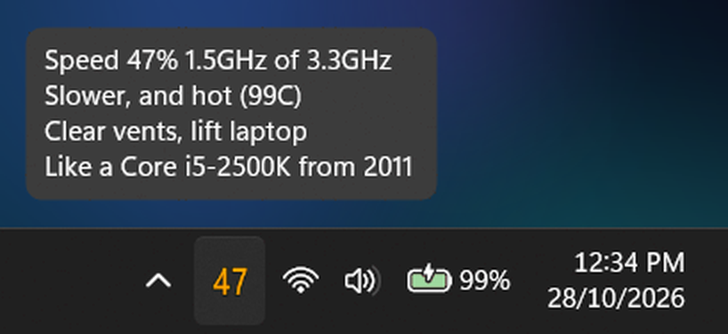
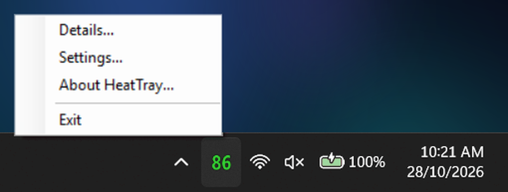
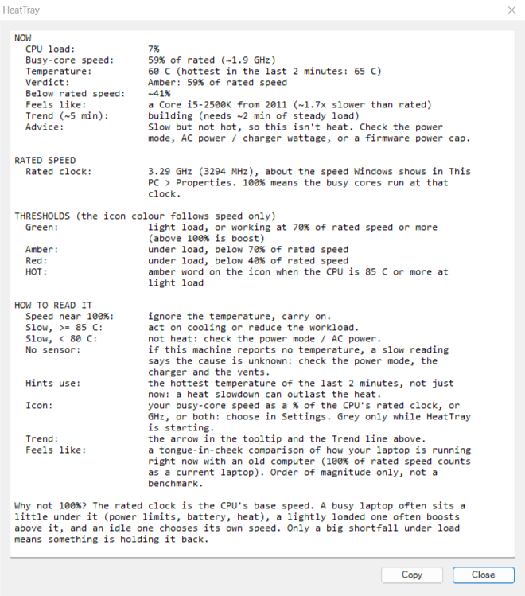
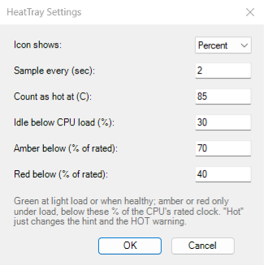

# HeatTray

**v2.2** (2026-10-28) by Andrew Reardon, andrewreardon@gmail.com

Shows in the system tray whether your CPU is actually running slower than it can, so you know when heat is genuinely costing you performance and when you can let it ride.

Two slow readings, two different causes. HeatTray tells them apart, so you know what to fix:

| Slow, **not hot**: check power mode and charger | Slow **and hot**: clear the vents |
|---|---|
|  |  |

*Staged for the pictures: the laptop was idle, so the idle threshold was lowered and the speed scaled down to look slow, and the temperature in the second picture was raised. In the left picture the 64C and the battery power are real.*

## How is this different from HWiNFO?

HWiNFO is the right tool for finding out *what* your CPU is doing. HeatTray answers one question, at a glance: **is this laptop running slower than it should, and does it matter right now?** Three things set it apart:

- It tells you what a slowdown feels like. When the icon goes orange or red, the tooltip adds a tongue-in-cheek line such as *Like a Pentium 4 2.4GHz from 2002*: a feel for how bad "slow" is that a clock reading never gives you. It is an order-of-magnitude joke with a scale behind it ([the ready reckoner](#the-ready-reckoner)).
- There is nothing to set up. The number is your busy cores' speed as a % of the CPU's rated clock, the figure Windows shows in **This PC > Properties** (for example 3.30 GHz). No calibration, no learning period, no file to keep.
- It boils it all down to one number and one colour. A hot CPU that is still at full speed stays green. It is a verdict, not a dashboard. Windows' own throttle counters can report "no throttling" while a chip is pinned at its power cap, and HWiNFO's *Average Effective Clock* counts idle time (accurate, but a different question), so a lightly loaded CPU can look half-throttled while its working cores run at full speed. HeatTray reads the busy-core speed instead.

It also needs nothing but Windows. HeatTray is one plain C# file compiled into one small exe, with no drivers, no admin rights and no other tools ([how it works](#how-it-works)). To build it yourself you need only the C# compiler that is already part of Windows, run at user level: `build.ps1`, or the single `csc.exe` command in [How `dist/HeatTray.exe` was built](#how-distheattrayexe-was-built). That suits tightly controlled servers and laptops: nothing to install or approve, and nothing to elevate. Rather not run someone else's exe? Read the source and compile it yourself.

## Getting started

No installer: [download the latest release zip](https://github.com/andrewreardon-au/HeatTray/releases/latest), extract it, and run `dist\HeatTray.exe`.

1. Double-click `dist\HeatTray.exe`.
2. Don't see the icon? Click the small **^** arrow near the clock to show hidden tray icons.
3. Give it about 15 seconds: the icon is grey while it takes its first readings.
4. To close it, right-click the icon > **Exit**.



### Keeping the icon visible

Right-click the taskbar > **Taskbar settings** > **Other system tray icons** > switch **HeatTray** on.

### Starting automatically at login

1. Right-click `HeatTray.exe` > **Create shortcut**.
2. Press **Win + R**, type `shell:startup` and press Enter.
3. Drag the shortcut into that folder. Delete it to turn autostart off.

### Upgrading from v1.x

Exit the old HeatTray first (only one copy can run), then replace the exe. Calibration is gone, so the number now means something different: **a % of the CPU's rated speed**, not of your own demo load. Your old `baseline.ini` is no longer read and can be deleted. Your `settings.ini` still loads; if it holds the old default thresholds (amber 85, red 70) they move to the new defaults (70 and 40), and any other values you chose are kept. If you want calibration back, [v1.3](https://github.com/andrewreardon-au/HeatTray/releases/tag/v1.3) is still on the releases page.

## What the icon shows

One big number, so it can be read at a glance:

```
 92      speed: % of the CPU's rated clock
```

The number is your CPU's busy-core speed as a % of its rated clock. 100 means the working cores run at the speed Windows shows in This PC > Properties; above 100 is boost. The colour of the number is about speed only, not temperature:

| Icon | Meaning |
|---|---|
| 🟢 Green | The load is light (under the idle threshold, 30% CPU load by default), or the CPU is working and running at 70% of its rated speed or more. The icon stays green when the load dips, so it doesn't change colour every few seconds |
| 🟠 Orange | Noticeably slowed (under 70%) while the CPU is working. Settings and the command line call this colour amber |
| 🔴 Red | Heavily slowed (under 40%) while the CPU is working |
| 🟠 Orange `HOT` | The load is light but the CPU is at 85 °C or more. It is a word, not a number, so it can't be mistaken for a slow reading |
| ⚪ Grey number | Starting up: the first readings take about 15 seconds |
| ⚪ Grey "?" | CPU counters unavailable: run `HeatTray.exe --diag` |

The text colours follow the Windows taskbar theme: bright shades on a dark taskbar, darker shades on a light one (and the outline flips from dark to light). If you change the Windows theme the icon follows within a few seconds.

You can change what the icon shows: **Settings > Icon shows** has **Percent** (the default), **GHz** (the current busy-core speed, e.g. `3.2`) or **Both** (percent over GHz on two lines, with smaller digits). The tooltip always has both. From the command line: `--show=percent|ghz|both`.

### Why isn't it 100%?

100% is the CPU's *rated* (base) clock. Real life lands around it, not on it:

- A busy laptop often sits a little under it: power limits, battery, a power-saver mode, or just heat.
- A lightly loaded CPU often boosts above it. Numbers over 100 are normal, and green.
- At light load (under the idle threshold, 30% CPU load by default) the cores choose their own speed to save power, which can be well under or over the rated one. That says nothing about heat, so a light-load reading is never orange or red.

Only a big shortfall **under load** means something is holding it back. That is what the orange and red thresholds look for.

Hover over the icon for the full picture. The first line is the speed, then the current clock *of* the rated clock (3.3GHz here, the figure Windows shows in This PC > Properties). Loaded and healthy:

```
Speed 92% 3.0GHz of 3.3GHz
Working hard, all fine
68C | load 74%
```

Slow and hot (the temperature moves into the second line, and the fourth line is the [ready reckoner](#the-ready-reckoner)):

```
Speed 18% 0.6GHz of 3.3GHz ▼
Too hot (now 73C, peak 96C)
Clear vents, lift laptop
Like a Pentium 4 2.4GHz from 2002
```

Light load:

```
Speed 110% 3.6GHz of 3.3GHz
Light load: core speed is variable
52C | load 8%
```

Line 1 is always the speed, the GHz, and a trend arrow when there is one (▲ rising, ► steady, ▼ falling over about the last 5 minutes of load). Lines 2 and 3 give the verdict and what to do. The verdicts and actions are:

| Tooltip says | Meaning |
|---|---|
| Working hard, all fine | Loaded and at 70% or more of rated speed. Even if it is hot, you are not being slowed, so carry on |
| Boosting: faster than rated | Loaded and above 100%: the CPU is boosting past its rated clock |
| Slower, and hot / Too hot, very slow (96C) | Slow **and** hot (85 °C+): clear the vents, lift the laptop off soft surfaces, or reduce the load. "(now 73C, peak 96C)" means it is no longer that hot but was within the last 2 minutes: a heat slowdown can outlast the heat |
| Slower, not hot (52C) | Slow with no sign of heat (under 80 °C, and not that hot at any point in the last 2 minutes): plug in, check the Windows power mode, the charger wattage, or a firmware power cap |
| Slower, warm (80C) | Slow and warm (80-85 °C): could be heat or a power limit, so watch whether it gets hotter |
| Slower, no temp sensor | Slow, and this machine reports no temperature, so the cause is unknown: try the power mode, the charger and the vents |
| Light load: core speed is variable | The load is under the idle threshold, so there is nothing to judge |
| Hot at light load | The load is light but the CPU is at 85 °C or more: something is trapping heat |
| Starting up | The first readings after launch |

"Far slower" replaces "Slower" when the icon is red. Whenever the heat has already eased, a slow verdict can end in "(now 60C, peak 82C)" in the same way as the hot ones.

Click the icon (or right-click > **Details...**) for the full breakdown: the temperature and its 2-minute peak, the verdict, how far below rated speed it is, the ready-reckoner feel, trend with GHz, the advice in a sentence, and the rated clock the percentage is taken from.



*Staged in the same way as the tray picture at the top, so the numbers are an example.*

### Rules of thumb

| Speed shown (under load) | Roughly | What to do |
|---|---|---|
| 70 and up | Little or no slowdown | Ignore the temperature, let it ride |
| 40-70 | Noticeable | Fine for bursts; if it stays here **and** it's hot, improve airflow; if it's cool, check the power mode and charger |
| Under 40 | Heavy | Address cooling (or the power mode) now |

A brief dip is normal. What matters is when it **stays** low.

### The ready reckoner

When the icon is orange or red, the tooltip gets a fourth line and Details gets a "Feels like" row: a tongue-in-cheek comparison of how your laptop is running right now with an old computer (100% of rated speed counts as a current laptop). It compares one core's speed only: an order-of-magnitude feel for *how bad is this*, not a benchmark.

| Speed (% of rated, approx.) | Feels like (and the year that CPU debuted) |
|---|---|
| 70 and up | as intended (no line shown) |
| 62-70 | a Core i5-4690 from 2014 |
| 46-62 | a Core i5-2500K from 2011 |
| 32-46 | a Core 2 Duo E8400 from 2008 |
| 21-32 | a Core 2 Duo E6600 from 2006 |
| 14-21 | a Pentium 4 2.4GHz from 2002 |
| 8.5-14 | a Pentium 4 1.8GHz from 2001 |
| 5-8.5 | a Pentium III 733 from 1999 |
| 1.9-5 | a Pentium II 400 from 1998 |
| 0.7-1.9 | a Pentium 166 from 1996 |
| 0.34-0.7 | a Pentium 60 from 1993 |
| 0.1-0.34 | a 486 DX2-66 from 1992 |
| 0.014-0.1 | a 386DX-16 from 1985 |
| under 0.014 | an abacus from 2400 BC |

The **Amber below** setting (the orange threshold) also decides when the line appears. It is not shown at light load or while starting up.

## Settings and command line

Right-click the icon > **Settings...** (left-click opens **Details**) to change what the icon shows (percent, GHz or both), the sample interval, the temperature that counts as "hot", the idle threshold and the speed thresholds (**Amber below** is the orange one). Changes apply immediately and are saved to `settings.ini` next to the exe. If a number is out of range, the box stays open instead of closing: the hint at the bottom turns red and says which setting and what range it takes, and the cursor goes to that box.



```
HeatTray.exe [options]

  -i <sec>, --interval=<sec>  seconds between samples (default 5)
  --warn=<C>                  temperature that counts as hot, for the hints and the
                              idle HOT warning (default 85)
  --gate=<pct>                CPU load % below which it counts as idle (default 30)
  --amber=<pct>               orange when speed is below this % of rated (default 70)
  --red=<pct>                 red when speed is below this % of rated (default 40)
  --show=<percent|ghz|both>   what the icon shows (default percent)
  --diag                      print which counters work and 5 live samples, then exit
  -h, --help                  show help and exit
  -v, --version               show version info and exit
```

With no options it uses the saved settings. With any valid option given, the command line wins and `settings.ini` is ignored (flags are never saved). `--diag` prints which counters work on this machine, the taskbar theme it detected, what the icon is set to show, plus five live samples. Run it first if something looks wrong on a colleague's PC.

## Limits worth knowing

- It measures the outcome (slower clocks) and a coarse ACPI temperature, not the chip's internal power and thermal limits. It can't tell you *why* the CPU is slow: the hint is a rule of thumb from speed vs temperature. Firmware power caps (sustained TDP limits), battery operation and Windows power modes (e.g. "Best power efficiency") all look identical to heat from here.
- The thresholds are for a typical laptop. On battery, or in a power-saving mode, a healthy CPU can run at 60-80% of its rated speed, so expect orange more often there, and the hint ("plug in, check the power mode") is then the right one. If your machine is orange all the time while performing normally, lower **Amber below** in Settings.
- Idle hides a slowdown at low load. Below the idle threshold (30% CPU load by default) nothing is judged, so a firmware clamp that bites at light load shows green. The only exception is `HOT`: an idle CPU at 85 °C or more turns the icon orange.
- A heat slowdown can outlast the heat. After a firmware thermal clamp the CPU can stay pinned at its lowest speed for 30-40 seconds while the temperature falls back below 80 °C (seen on a laptop resting on a pillow: 96 °C, then ~0.5 GHz for 36+ seconds until it had cooled to ~73 °C). So the hints go by the hottest temperature of the last 2 minutes, not just the current one, and say so (`Too hot (now 73C, peak 96C)`). A clamp that outlasts those 2 minutes can still read as "Slower, not hot"; if it was hot a few minutes ago, treat it as cooling.
- The rated clock comes from the registry (`~MHz`, the speed Windows shows in This PC > Properties). If a machine does not report it (some VMs), the GHz is left out and the percentages still work.
- The light/dark choice follows the Windows system theme setting. With an unusual taskbar colour (a very light accent colour, high contrast) the icon text can be harder to read; the outline helps.
- Some machines (desktops, some VMs) don't expose a thermal zone. Speed still works, and a slow reading then says "no temp sensor" because the cause is unknown. Where there is a sensor, it reports whole degrees only and updates slowly.
- The Windows counter names are English-only: on a non-English Windows the counters fail to open and the icon shows a grey "?". `--diag` will say so.
- Windows' ACPI zone temperature typically reads a few degrees different from the CPU core sensor (the reading HWiNFO calls Tctl). Tune `--warn` for your hardware.
- The exe is unsigned. If SmartScreen or IT policy blocks a copy from a network share or USB drive, right-click > Properties > **Unblock**, or rebuild locally with `build.ps1` (it uses the C# compiler that ships with Windows, no downloads).

## How it works

It reads three standard Windows performance counters:

- `Processor Information\% Processor Performance`: how fast the cores run *while they are working*, relative to their rated speed (it can exceed 100% when boosting). GHz is this times the CPU's nominal clock.
- `Processor Information\% Processor Time`: how busy the CPU is (deliberately *not* `% Processor Utility`, which is itself scaled by clock speed and would hide a hard throttle by making a busy CPU look idle).
- `Thermal Zone Information\Temperature`: the hottest ACPI thermal zone.

Readings are smoothed over the last 3 samples (about 15 seconds). Above the idle threshold (30% load) the speed is coloured green, orange or red by the thresholds. Below it the same percentage is shown in green, and never orange or red; the one exception is `HOT` when the temperature is at or above the hot threshold.

## What's new in v2.2

- **Clearer advice.** When the CPU is slow and not hot, the action line now reads *Plug in, check power mode*.

## What's new in v2.1

- **The tooltip shows the rated clock.** Line 1 now reads `Speed 61% 2.0GHz of 3.3GHz`: the current clock out of the CPU's rated one.
- **Sampling every 5 seconds by default** (was 2). The smoothing and the trend windows were rescaled to match, so the colour reacts as fast as before and the trend still looks back about 5 minutes.
- **The icon digits match PingTray's**: same font weight and the same size for every two-digit number.

## What's new in v2.0

- **No calibration.** The number is the busy-core speed as a % of the CPU's rated clock, so there is nothing to set up, no `baseline.ini` and no learning period. (The v1.x reference was one person's demo load; a demo that changes shape made it stale.)
- **New defaults for the colours:** orange under 70%, red under 40% of rated speed. If your `settings.ini` still has the old defaults (85 and 70) they move to these; custom values are kept.
- **Light load looks reassuring.** The icon stays green while the load is under the idle threshold, and the tooltip says why the figure is not 100: *Light load: core speed is variable*. Values over 100 are shown as they are, with the tag *Boosting: faster than rated*.
- **`HOT` at light load.** A lightly loaded CPU at 85 °C or more shows the word `HOT` in orange instead of a number.
- **A tooltip that says what to do.** Slow readings now have a verdict line with the temperature and an action line (*Clear vents, lift laptop*, *Plug in, check power mode*). A machine with no temperature sensor says *no temp sensor* instead of claiming the CPU is not hot.
- **A proper start-up state.** For the first ~15 seconds the icon is grey and the tooltip says *Starting up*, instead of briefly reading *Idle* under load.
- Details has a **Why not 100%?** note and shows the rated clock the percentage is taken from.

## What's in this repo

| Path | What it is |
|---|---|
| `src/HeatTray.cs` | The entire app: one plain C# file, no dependencies beyond .NET Framework |
| `src/HeatTray.ico` | The exe's embedded icon |
| `dist/HeatTray.exe` | Prebuilt, ready-to-run binary |
| `build.ps1` | Rebuilds `dist/HeatTray.exe` from source on your own machine |
| `make-icon.ps1` | Regenerates `src/HeatTray.ico` (only needed if you change the artwork) |
| `README.txt` | This guide as plain text, for the zip |
| `screenshots/` | The images in this README |
| `LICENSE` | MIT |

## How `dist/HeatTray.exe` was built

```powershell
csc.exe /nologo /target:winexe /platform:x64 /out:dist\HeatTray.exe /win32icon:src\HeatTray.ico `
    /reference:System.Windows.Forms.dll /reference:System.Drawing.dll src\HeatTray.cs
```

`csc.exe` is the one bundled with .NET Framework 4 (`C:\Windows\Microsoft.NET\Framework64\v4.0.30319`). Or just run `build.ps1`.

SHA-256 of the committed `dist/HeatTray.exe` (v2.2): `4F9E2267874B6993B0EEDCF3BB85770BD6FFF2B51E4161F5E9E3FB9352CCC249`

## License

MIT, see [LICENSE](LICENSE).
